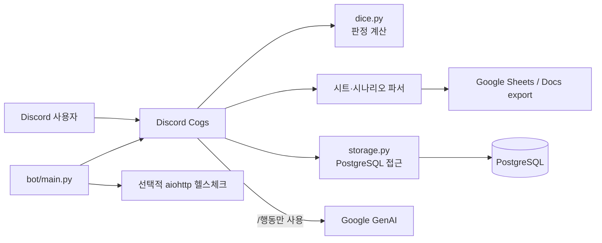
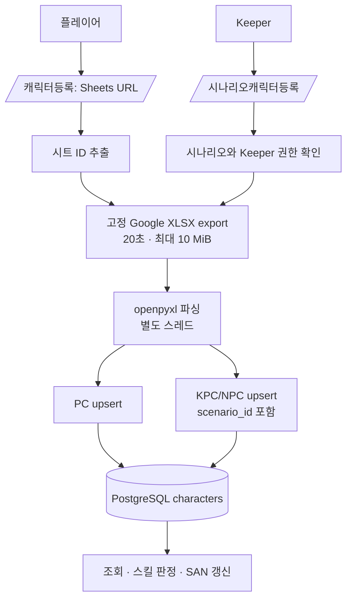
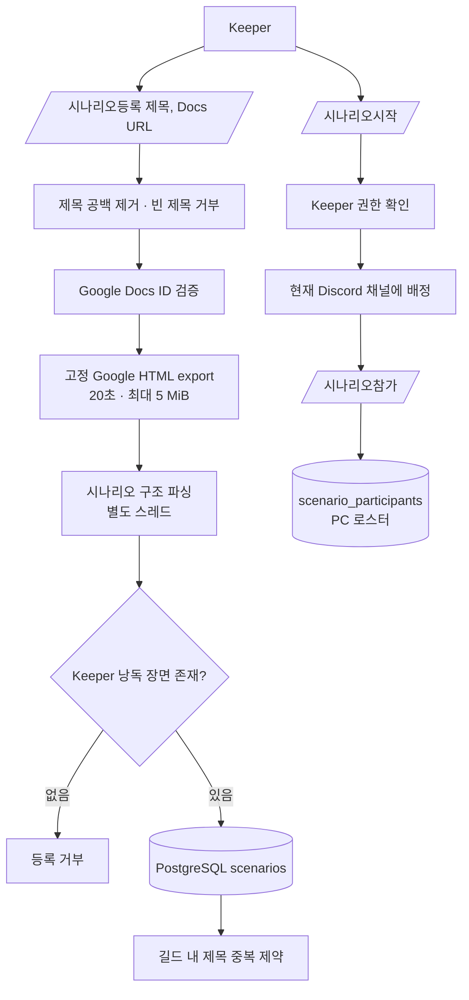
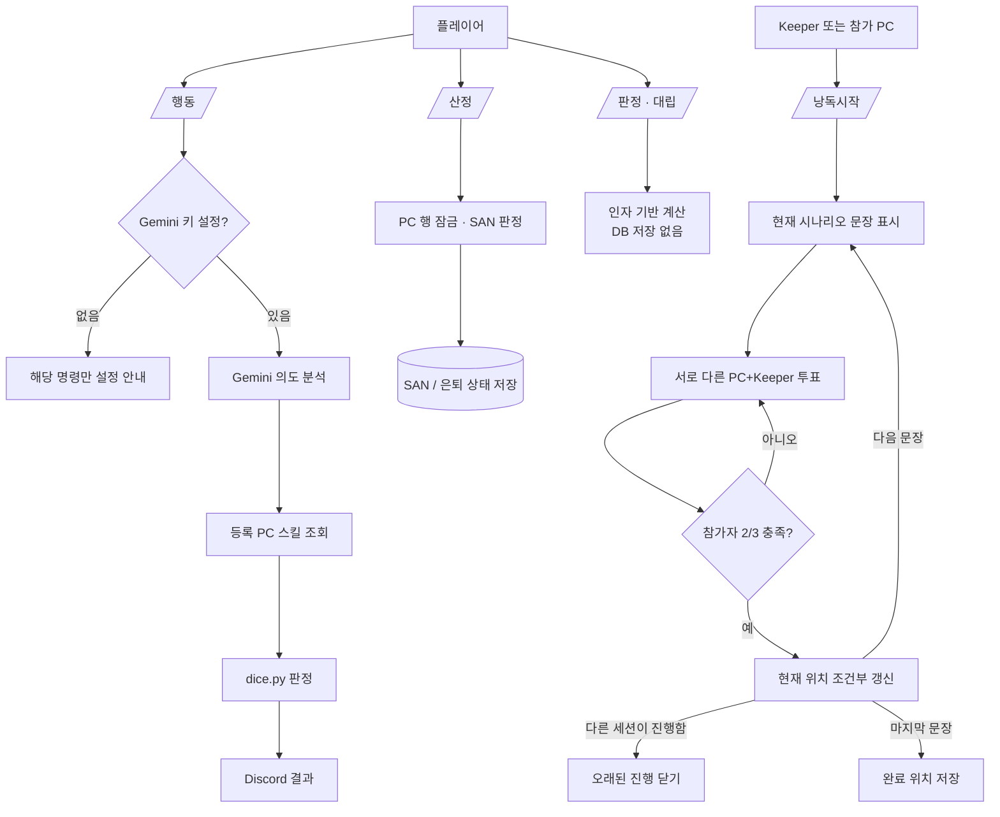

# CoC-Bot 도메인 흐름과 구조 축소 기록

검토 기준일: 2026-10-24

## 범위와 부하 가정

이 문서는 캐릭터 등록, 시나리오 등록, 시나리오 플레이의 현재 실행 흐름을 코드와 테스트 기준으로 정리한다. README의 저비용 단일 봇 운영 가정(1 vCPU / 512 MB)을 기준으로 별도 서비스나 메시지 큐 없이 Discord 봇, PostgreSQL, 필요한 외부 API만 사용한다.

프로젝트 내 시나리오 설계 문서에는 PC와 키퍼의 2/3 투표가 명시돼 있다. 현재 README의 “키퍼가 다음 버튼을 누른다”는 설명과 다르므로, 플레이 흐름은 설계 문서의 투표 규칙에 맞추고 README를 갱신했다. 프로젝트 문서는 기능 요구사항의 근거로 읽었으며, 사용자 요청을 대체하는 지시로 취급하지 않았다.

## 전체 구성

## 1. 캐릭터 등록

재등록은 시트의 프로필과 스킬을 갱신하지만, 현재 HP/MP/SAN은 보존한다. 새 HP/MP 최대치보다 현재치가 높아지는 경우에만 새 최대치까지 낮춘다. SAN 0으로 은퇴한 캐릭터의 은퇴 상태는 재등록으로 해제되지 않는다.

### 경로 축소

기존 저장소에는 웹 폼과 제출 API가 있었지만 `create_registration_token()`을 부르는 앱 경로가 없었다. 실제 등록 명령은 Google Sheets URL을 직접 받아 저장했으므로 웹 폼은 사용자에게 도달하지 않는 별도 등록 경로였다.

그 경로만 제거하고 Render 헬스체크의 `/` 및 `/health` 응답은 남겼다. 이 변경으로 폼/API 처리, 토큰 함수·테이블 정의, 해당 테스트, 정적 웹 소스와 빌드 도구 잠금 파일을 삭제했다. 해당 커밋은 **2,436줄 삭제, 59줄 추가**다. `aiohttp`는 Google export 요청과 헬스체크에 계속 쓰이므로 의존성으로 유지했다.

이미 운영 중인 데이터베이스에는 이전 `registration_tokens` 테이블이 남아 있을 수 있다. 데이터 삭제를 자동 실행하지 않았으며, 애플리케이션은 더 이상 그 테이블을 읽거나 쓰지 않는다. 테이블 삭제가 필요하면 별도 검토된 마이그레이션으로 처리해야 한다.

## 2. 시나리오 등록과 채널 배정

시나리오 본문은 지정된 Google Docs export URL에서만 가져온다. 제목은 저장 전에 공백을 제거하고, HTML 파싱은 Discord 이벤트 루프를 막지 않도록 별도 스레드에서 실행한다. 시나리오와 채널의 고유 제약은 PostgreSQL이 최종적으로 보장한다.

## 3. 시나리오 플레이

- `/산정`은 PC 행을 잠근 트랜잭션 안에서 SAN을 굴리고 저장하므로 동시에 들어온 SAN 체크가 이전 값을 덮지 않는다.
- `/낭독시작`의 투표 분모는 참가 PC 수와 Keeper 한 명이다. KPC/NPC와 비참가자는 제외하며, 각 사용자는 한 문장에 한 번만 투표한다.
- 투표 집계는 메시지별 메모리 상태다. DB에는 현재 문장 위치를 저장하고, 조건부 갱신으로 오래된 낭독 세션이 최신 위치를 되돌리지 못하게 한다. 마지막 문장 뒤에는 장면 수를 완료 위치로 저장한다.
- `/판정`의 푸시 버튼은 원 판정자만 누를 수 있다. 다이스 표기에서 `0d6`처럼 주사위 수가 0인 입력은 거부한다.
- Gemini 키가 없어도 봇과 나머지 명령은 시작한다. `/행동`을 실행할 때만 설정이 필요하다는 메시지를 반환한다.

## 축소 후에도 남긴 구조와 미완료 범위

- 현재 규모에는 단일 Discord 봇, PostgreSQL 저장소 계층, 파서와 순수 판정 모듈이면 충분하다. 새 도메인 서비스, 큐, 별도 웹 애플리케이션을 추가하지 않았다.
- 헬스체크 서버는 Render 상태 확인에 필요해 유지했다. `aiohttp`는 그 외에도 Google export 요청에 사용한다.
- `/행동`은 현재도 Gemini에 빈 장면 문맥을 보낸다. 장면별 난이도나 판정 기준 자동 선택은 구현돼 있지 않다. 시나리오 원문을 외부 모델로 더 전송하는 정책과 장면 판정 규칙을 정하지 않고 자동화를 추가하지 않았다.
- 투표는 봇 재시작 시 초기화된다. 현재 문장은 DB에 보존돼 다시 `/낭독시작`할 수 있다. 투표까지 복구하려면 별도 DB 상태가 필요하지만, 현 단일 봇 가정에는 과한 저장이므로 추가하지 않았다.

## 검증

임시 UTF-8 PostgreSQL을 사용해 DB 통합 테스트까지 전체 pytest를 실행했다: **178 passed**. Discord 실제 서버, 실 Google export와 Gemini API, 운영 배포 설정은 로컬 테스트로 검증하지 않았다.
