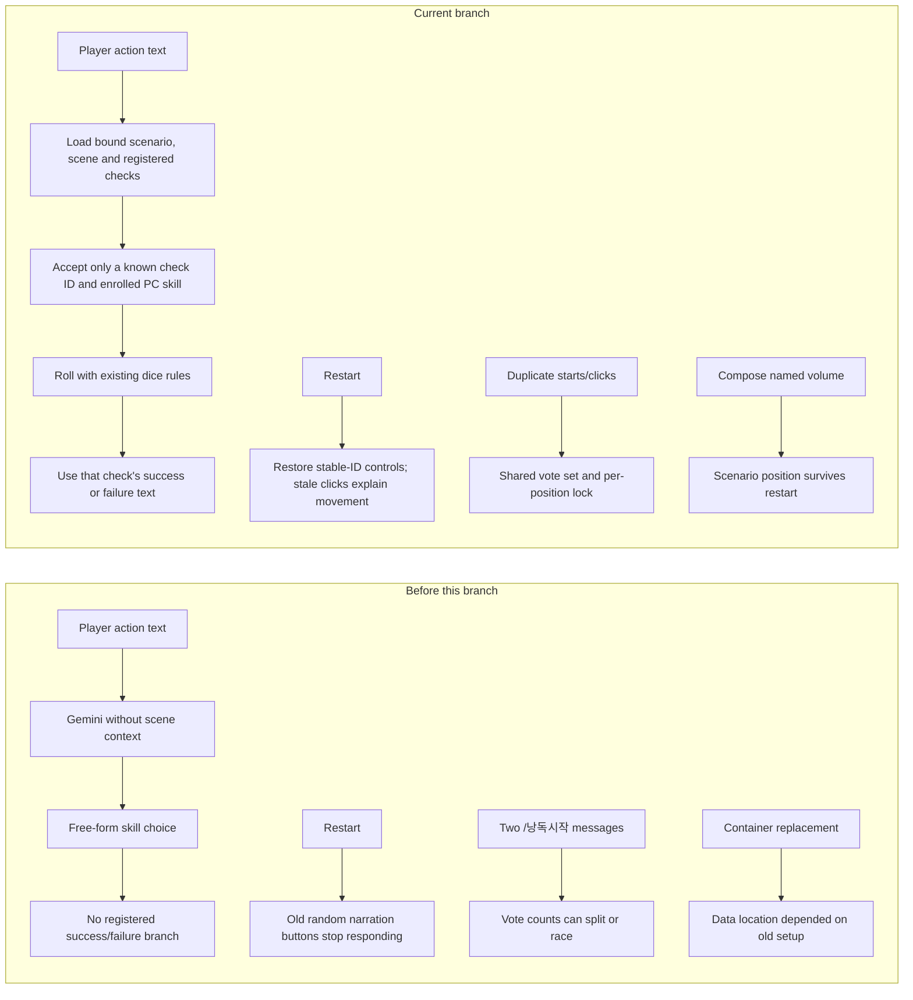
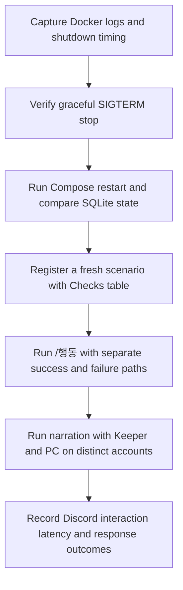

# Playtest failures, outcomes, and follow-up

Updated 2026-10-26 after the local remediation build. This report separates earlier observed behavior from current branch verification. Dice outcomes are gameplay results, not technical failures.

## What happened

| When | Action | Expected | Actual result | Count / status |
|---|---|---|---|---|
| 2026-10-24, Discord | `/시나리오조회` twice and `/판정 스킬값:50` | Discord should acknowledge and answer each command | All three showed “애플리케이션이 응답하지 않았어요”. The bot was online; endpoint URL was empty, Gateway Intent active, and application-command permission was enabled in the checked channel. The deployed process, revision, and logs were unavailable, so the production cause could not be established. | 3 interaction timeouts; unresolved historically |
| 2026-10-26, Discord | First `/행동` request | Gemini should analyze the action | Gemini returned HTTP 404 for `gemini-2.5-flash`; the user saw the generic command error. These are one failed request, not two. | 1 provider failure |
| 2026-10-26, local rebuild | Retry `/행동` after changing the model ID | Analysis should complete | The request succeeded with `gemini-3.8-flash`. The recorded action chose Observe 65 and rolled 50, a success. At that time no scene context was supplied, so this one correct-looking choice did not prove scenario awareness. | 1 retry succeeded; behavior gap found |
| 2026-10-26, Discord session notes | `/시나리오등록` | Register the fictional playtest scenario | First request returned a generic error; retry registered the scenario and parsed 3 scenes. The specific underlying error was not recorded. | 1 failed attempt, 1 successful retry; cause unknown |
| 2026-10-26, Discord session notes | `/판정` | Show the manual check result | A roll of 55 succeeded, then the interaction callback errored because a view was explicitly passed as `None`. The code was fixed before this branch's remediation work. | 1 post-roll response failure; fixed earlier |
| 2026-10-26, Discord session notes | `/행동` | Analyze the action | A separate Gemini 503 was recorded. The response was an error; no successful roll is recorded for that request. | 1 provider failure; no production log retained |
| 2026-10-26, Discord session notes | Old narration button after a bot restart | Existing button should continue | Discord reported that the application did not respond. Old controls had random IDs and were not restored after restart. | 1 stale-control timeout; current recovery path added, but old buttons cannot be revived |
| 2026-10-26, local Docker replacement | Stop old container | Container should stop within the graceful timeout | `docker stop --time 30 coc-bot` waited 30 seconds and then ended with exit 137 (forced kill). Old container logs were not captured before removal, so the shutdown cause is unknown. The replacement started and is healthy. | 1 forced termination; investigate |
| 2026-10-26, current audit | First DB verification query | Read scenario positions | Query used a guessed table name and returned “no such table”. Reading the schema showed the correct table is `scenarios`; the corrected read-only query succeeded. No database data was changed. | 1 audit-command error; not an application failure |

The count of recorded Discord/API request failures is **8** across the dated runs: 3 interaction timeouts on Oct 24, 1 Gemini 404, 1 scenario-registration attempt, 1 manual-roll callback failure, 1 separate Gemini 503, and 1 stale narration control timeout. The generic error shown for the Gemini 404 is included in that same event. The Docker forced termination is a separate operational failure, and the mistaken audit query is a separate verification-tool error. These counts are from the preserved notes, not a single continuous run.

## Ordinary dice results from the first playtest

| Command | Roll(s) | Result | Interpretation |
|---|---:|---|---|
| `/행동` | Observe 65; 50 | Success | A random game result. The selected skill happened to match the scene, but the implementation did not yet receive the scene. |
| `/판정` plus push | 88, then 89 at skill 65 | Both fail | Normal dice results; push button worked once for the roller. |
| `/산정 0/1d4` | 55 | Success; SAN loss 0; SAN stayed 60/60 | Normal result; storage was read back successfully. |
| `/대립` | 90 and 72 at skills 65 and 50 | Both fail; higher skill was shown as winner | Normal result under the existing opposed-check ranking rule. |
| `/낭독시작` | 11 narration lines | Reached completion and lookup showed complete | Sequential flow worked. Keeper and PC were the same Discord account, so this did not test a two-account quorum. |

These rolls include four failed game checks (two `/판정` rolls and two rolls inside one `/대립` command). They are not evidence of bot defects. The `/산정` check succeeded and caused no loss.

## Current branch verification

The branch now includes scenario-aware action resolution, persistent narration controls, race-safe voting, and local Compose persistence. Current evidence:

| Check | Result |
|---|---|
| Automated suite | `217 passed, 1 warning` in 0.90s. The warning is Python's `audioop` deprecation emitted by the installed Discord voice module. |
| Local health endpoint | HTTP 200 before and after Compose restart. |
| SQLite integrity | `PRAGMA integrity_check` returned `ok` before and after restart. |
| Saved scene positions | Before and after restart: `[(1, 0, 0), (2, 3, 0)]`; no position change. |
| Docker Compose | Container is running and bound to `127.0.0.1:18080`; the existing `coc-bot-data` volume was reused. Compose warned that this pre-existing volume was not created by Compose. This was benign for the existing installation. |
| External deployment | None; work and verification used the local Docker service. |

At startup, Discord.py also warns that PyNaCl and `davey` are absent (voice playback unavailable), and that the privileged message-content intent is missing. Slash commands connected to the Gateway in the observed run; neither warning has been shown to cause the historical interaction timeouts.

## How the behavior changed

`/행동` now uses the actual scene and its registered check rules. It does not let the model invent a skill or dice result: the model must return a known rule ID; the bot validates the rule, the PC, and the skill, then rolls using existing dice code. An ambiguous or invalid match does not roll and leaves `/판정` as the manual fallback. Automatic scenario-ending selection is still a Keeper choice; the current checks provide success/failure narration for registered actions, not an entire autonomous GM.

Narration buttons created by the new code have stable IDs and are restored at startup. The button clicks read the saved database position; a stale click explains that the position has moved. Votes are in memory and reset after restart, with a notice on the next valid vote. Old buttons created with random IDs cannot be restored; use `/낭독시작` to get a button for the current saved line. If Keeper and PC share a Discord account, they remain one eligible voter by design.

## What remains unverified and what to investigate next

1. **Historical Discord timeouts:** collect the actual runtime's revision, process logs, interaction acknowledgement timing, Gateway reconnects, and Discord API errors if a timeout recurs. The Oct 24 deployed instance was not available, so its root cause remains unknown.
2. **Forced Docker stop:** capture `docker inspect` state and logs before replacement; check SIGTERM handling and shutdown hooks, then verify stop completes within the configured grace period. Exit 137 alone does not identify which shutdown step stalled.
3. **Live scenario-aware action:** current automated tests exercise registered rule mapping and error cases, but this report does not claim a new live Discord run of the changed `/행동` flow. A live run needs a scenario document with a `Checks` table and a real PC with the named skills.
4. **Two-account narration quorum:** the earlier Discord test used one account for Keeper and PC. Validate one vote does not advance and the second eligible account does, using two distinct accounts.
5. **Google export variations:** tests parse a representative Docs HTML table. Verify a fresh real Docs export with the optional `Checks` table, including missing/duplicate IDs and unregistered skill names.
6. **Volume warning on a new host:** existing data was preserved, but Compose warns when reusing the pre-existing named volume. A clean installation should explicitly create the volume or declare it external in Compose and document that setup.
7. **Provider reliability:** tests cover mocked provider failures; live 404/503/timeout cases were not triggered again. Keep the model identifier and provider status in diagnostics without logging credentials or prompt contents.

## Recommended order

