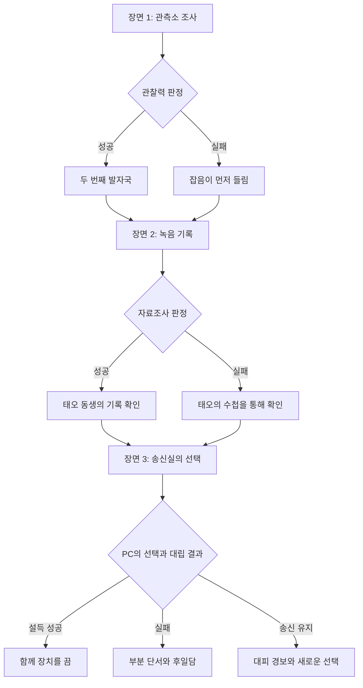

# 유리파 관측소

## 시나리오 개요

- 장르: 현대 한국 배경의 조사·심리 호러
- 권장 인원: Keeper 1명, PC 1명, KPC 1명
- 예상 시간: 60–90분
- 중요 주제: 기억, 애도, 타인의 선택
- 안전 안내: 갑작스러운 소리와 상실을 다룹니다. 불편한 소재는 세션 전에 합의하고 언제든 장면을 건너뛸 수 있습니다.

### 진행 원칙 (Keeper 참고)

이야기의 중심은 파도 소리를 녹음하는 오래된 관측 장치입니다. 장치는 미래를 정확히 예언하지 않습니다. 듣는 사람이 두려워하는 장면을 현재의 소리와 섞어 재생할 뿐입니다. 주사위는 단서를 얻는 방식과 대가를 정하는 도구로 쓰고, 실패해도 조사를 멈추지 말고 단서의 비용이나 위험을 바꾸세요.

PC는 기록 사진을 맡은 조사자 **한서윤**입니다. KPC **윤태오**는 유리파 관측소의 임시 기록원이며, PC를 관측소로 부른 사람입니다. 태오는 동생의 마지막 음성이 장치에 남아 있다고 믿습니다.

# 1부: 방파제의 초대

## 장면 1: 닫힌 관측소

### Keeper

해 질 무렵, 바닷바람이 방파제의 난간을 울립니다. 유리파 관측소의 창문에는 안쪽에서 닦은 듯한 둥근 자국이 남아 있습니다. 윤태오는 열쇠를 쥔 손을 주머니에 감추며 말합니다. 「기록 장치가 어젯밤부터 사람 목소리를 돌려주고 있어요.」

### Checks

| id | skill | action | success | failure |
|---|---|---|---|---|
| window-tracks | 관찰력 | 관측소 창틀과 모래의 흔적을 살핀다. | 젖지 않은 모래에서 두 번째 발자국을 발견한다. | 발자국은 놓치고 관측소 안쪽에서 잡음이 먼저 들린다. |
| taeo-expression | 심리학 | 태오의 표정과 말투를 살핀다. | 태오가 녹음 재생을 두려워하기보다 기다리고 있음을 알아챈다. | 숨기는 이유는 알 수 없지만 태오는 조사에 협조한다. |

### 진행 메모

- 먼저 플레이어가 무엇을 살피는지 자유롭게 말하게 합니다. `/행동`에는 그 행동을 자연어로 적습니다.
- 관측소 주변의 흔적을 자세히 찾으면 **관찰력 65**를 권합니다. 성공하면 젖지 않은 모래 위의 두 번째 발자국을 발견합니다. 실패해도 문은 열리지만, 발자국은 놓치고 안쪽에서 먼저 잡음이 들립니다.
- 태오의 표정과 말투를 살피면 **심리학 50**을 권합니다. 성공하면 태오가 녹음 재생을 두려워하는 게 아니라 기다리고 있음을 알아챕니다. 실패하면 그가 숨기는 이유는 알 수 없지만, 태오는 조사에 협조합니다.
- 낭독 투표를 시험할 경우 장면 문장을 한 번에 하나씩 진행합니다.

## 장면 2: 두 번째 기록

### Keeper

관측실 중앙에는 유리 원판이 겹쳐진 녹음 장치가 있습니다. 회전축은 멈춰 있는데도, 헤드폰에서는 파도와 함께 누군가 숫자를 세는 소리가 납니다. 녹음 날짜는 내일입니다. 마지막 숫자가 끝나자, 관측소 바깥에서 같은 리듬으로 세 번 두드리는 소리가 납니다.

### Checks

| id | skill | action | success | failure |
|---|---|---|---|---|
| record-date | 자료조사 | 녹음 날짜와 기상 기록을 대조한다. | 내일의 폭풍 경보와 태오 동생의 목소리가 같은 시간표에 기록되었음을 확인한다. | 날짜는 확인하지만 기록 순서가 뒤섞여 태오에게 재생을 부탁해야 한다. |

### 진행 메모

- 날짜와 기록을 대조하는 행동에는 **자료조사 60**을 권합니다. 성공하면 장치가 내일의 폭풍 경보와 태오 동생의 목소리를 같은 시간표에 기록했다는 점을 확인합니다. 실패하면 날짜는 확인하지만 기록 순서가 뒤섞여, 다음 장면에서 태오에게 재생을 부탁해야 합니다.
- 원판에 맨손으로 닿거나 녹음을 끝까지 들으면 Keeper가 `/산정 0/1d4`를 실행합니다. SAN은 정신적 충격을 견디는 수치입니다. 현재 봇은 이 체크를 실제 PC 수치에 반영하지만, 성공·실패에 따른 이 장면의 분기 문장을 자동 선택하지 않습니다.
- 플레이어가 녹음을 거부하거나 다른 방법을 찾으면 그 선택을 존중합니다. 다음 장면으로 갈 단서는 태오의 기록 수첩에서 얻을 수 있습니다.

## 장면 3: 송신실의 선택

### Keeper

송신실의 스피커에서 태오의 목소리가 흘러나옵니다. 그러나 태오는 당신들 바로 옆에 서 있습니다. 녹음 속 목소리는 「문을 닫아. 이번에는 내가 남을게.」라고 말하고, 관측소 아래쪽에서 잠금쇠가 움직이는 소리가 답합니다. 태오는 송신기의 전원을 끄려 하지만, 한 손으로는 낡은 수신기를 놓지 못합니다.

### Checks

| id | skill | action | success | failure |
|---|---|---|---|---|
| taeo-persuade | 설득 | 태오가 수신기를 내려놓도록 설득한다. | 태오가 수신기를 내려놓고 함께 전원을 끈다. 마지막 녹음은 끊기지만 파도 소리 사이에 현재 태오의 숨소리가 남는다. | 태오가 혼자 수신기를 붙든 채 전원을 내린다. 단서는 일부만 보존되고 PC는 그가 이 장소를 떠나지 못한 이유를 나중에 듣는다. |

### 진행 메모

- PC는 태오를 설득해 함께 전원을 끄거나, 장치를 직접 끄거나, 송신을 유지해 목소리의 주인을 확인할 수 있습니다.
- 태오와 말로 맞서는 장면을 주사위로 시험하려면 **설득 50 대 심리학 50**으로 `/대립`을 사용합니다. 봇은 두 수치를 받아 대립 판정은 하지만 등장인물의 신념이나 분기 결과를 읽지는 않습니다.
- 성공: 태오가 수신기를 내려놓고 함께 전원을 끕니다. 마지막 녹음은 끊기지만, 파도 소리 사이에서 현재 태오의 숨소리가 남습니다.
- 실패: 태오가 혼자 수신기를 붙든 채 전원을 내립니다. 단서는 일부만 보존되고, PC는 태오가 왜 이 장소를 떠나지 못했는지 나중에 듣게 됩니다.
- 다른 선택: 송신을 유지하면 경보 장치가 작동하고 관측소는 대피를 요구합니다. PC가 남긴 기록에 따라 태오의 결말을 Keeper가 정합니다.
- 이 분기들은 이번 테스트의 **정답표**입니다. 현재 봇이 자동으로 분기를 고르는지 시험할 때, 실제 결과와 기대 결과를 비교합니다. 오늘의 봇에서는 Keeper가 주사위 결과를 보고 직접 알맞은 문장을 선택해야 합니다.

## Keeper 빠른 참조

| 장면 | 지문 예시 | 권장 판정 | 성공하면 | 실패해도 이어지는 길 |
|---|---|---|---|---|
| 닫힌 관측소 | “창틀과 모래의 흔적을 비교한다.” | 관찰력 65 | 두 번째 발자국 발견 | 잡음이 먼저 들림 |
| 두 번째 기록 | “녹음 날짜와 기상 기록을 대조한다.” | 자료조사 60 | 기록의 연결 확인 | 태오의 수첩을 확인 |
| 두 번째 기록 | “원판을 만지거나 끝까지 듣는다.” | SAN 0/1d4 | 충격을 견딤 | 손실 후 단서 획득 |
| 송신실 | “태오가 수신기를 내려놓도록 설득한다.” | 설득 50 대 심리학 50 | 함께 전원을 끔 | 부분 단서와 후일담 |

## 분기 흐름

이 문서는 플레이테스트용 오리지널 자료이며 공식 규칙서나 공식 시나리오를 대체하지 않습니다.
