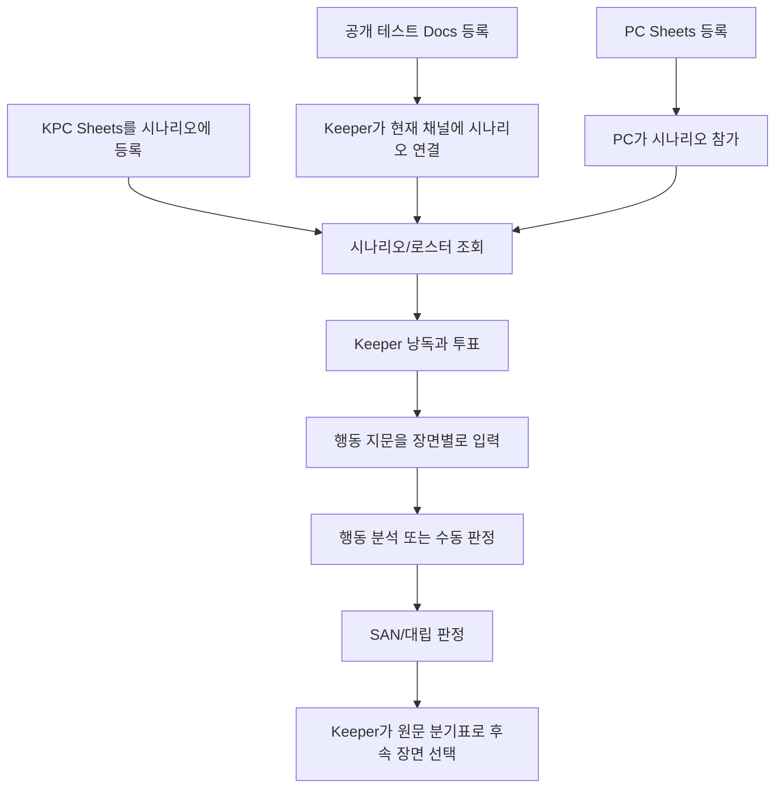

# 유리파 관측소 — 전체 Discord 기능 테스트 계획

## 1. 목표와 범위

이 문서는 유리파 관측소와 한서윤(PC), 윤태오(KPC)를 사용해 **현재 등록된 Discord 슬래시 명령 12개**를 시나리오 등록부터 진행 종료까지 점검하기 위한 실행 계획입니다. 정상 흐름뿐 아니라 잘못된 링크, 권한 부족, 캐릭터/시나리오 누락, 경계 입력, 외부 서비스 장애, 중복 요청, 진행 상태 저장을 포함합니다.

이 문서는 실행 계획과 결과를 함께 기록합니다. 2026-10-26 로컬 Docker에서 기본 종단 간 흐름을 실행했고, 오류·권한·경계 조건은 자동화 테스트와 별도로 구분합니다. 아래 실행 기록은 이번 테스트 채널과 가상 자료에 한정됩니다.

### 테스트 대상 명령 12개

/시나리오등록, /시나리오시작, /시나리오참가, /시나리오조회, /캐릭터등록, /캐릭터조회, /시나리오캐릭터등록, /낭독시작, /행동, /판정, /산정, /대립.

독립된 /채널등록 명령은 없습니다. /시나리오시작이 실행된 채널을 해당 시나리오에 연결합니다.

## 2. 시나리오 기준값과 현재 구현의 경계

시나리오 원문은 [scenario.md](scenario.md), 등록 캐릭터 값은 [characters.md](characters.md)를 기준으로 합니다.

| 장면/행동 | 원문에서 기대하는 판정 | 성공 | 실패해도 이어지는 길 |
|---|---|---|---|
| 장면 1: 흔적 조사 | 관찰력 65 | 젖지 않은 모래의 두 번째 발자국 | 잡음이 먼저 들림 |
| 장면 1: 태오 표정 살피기 | 심리학 50 | 태오가 두려워하기보다 기다리고 있음을 파악 | 이유는 모르지만 조사는 계속됨 |
| 장면 2: 날짜·기록 대조 | 자료조사 60 | 폭풍 경보와 동생 목소리의 기록 시각 확인 | 태오의 수첩으로 진행 |
| 장면 2: 원판 접촉/녹음 완청 | SAN 0/1d4 | SAN 손실 결정 | 손실을 반영하고 단서는 제공 |
| 장면 3: 태오 설득 | 설득 50 대 심리학 50 | 함께 송신기를 끔 | 태오가 혼자 끄고 부분 단서를 남김 |
| 장면 3: 다른 선택 | PC가 송신 유지 또는 직접 전원 차단 | Keeper가 선택에 맞춰 후속 진행 | 송신 유지 시 대피 경보 및 Keeper 결정 결말 |

**구현 기준선:** /행동은 Gemini에 자유 서술을 보내 판정 여부와 스킬을 분석하지만, 현재 장면의 원고나 Keeper 메모를 넘기지 않습니다. scene_context는 빈 문자열입니다. 그래서 원문에 맞는 스킬을 항상 고르거나 성공·실패에 따라 분기 문장을 자동 선택한다고 기대할 수 없습니다. 현재 상태를 시험할 때는 실제 선택과 정답표 차이를 기록하고, 자동 분기 기능이 아직 없는 것은 구현 결함과 구분합니다. /대립도 두 기능값의 주사위 판정만 처리하며 태오의 신념과 서사 분기는 Keeper가 해석합니다.

## 3. 쉬운 용어 설명

| 용어 | 쉬운 뜻 | 이 계획에서 확인하는 것 |
|---|---|---|
| 슬래시 명령 | Discord 입력창에서 /로 고르는 봇 기능 | 12개 명령을 실제 입력으로 실행 |
| PC | 플레이어가 직접 맡는 캐릭터 | 한서윤, 플레이어 계정에 등록하고 참가 |
| KPC | Keeper가 맡는 주요 이야기 캐릭터 | 윤태오, 시나리오에 등록하지만 플레이어 투표자에는 넣지 않음 |
| 기능치 | 특정 일을 해낼 가능성을 나타내는 0–100 값 | 관찰력 65, 자료조사 60 등 |
| d100 판정 | 1부터 100까지 굴려 기능치와 비교하는 판정 | /판정 또는 /행동 결과 확인 |
| SAN | 무서운 일을 견디는 정신 수치 | /산정 후 저장된 현재 값 확인 |
| 푸시 | 위험을 감수하고 실패한 판정을 한 번 더 시도 | 원 판정 실행자만 1회 누를 수 있는지 확인 |
| 낭독 투표 | 다음 낭독 문장으로 이동할지 참가자가 동의하는 절차 | Keeper와 PC가 모두 동의해야 하는 조건 확인 |
| SQLite | 봇이 진행 정보를 저장하는 로컬 데이터베이스 | 등록/참가/SAN/낭독 위치가 실제 저장되는지 확인 |
| 에페메럴 응답 | 명령을 실행한 사람만 볼 수 있는 비공개 응답 | 입력 오류와 권한 거부 응답 확인 |

## 4. 준비 및 안전한 테스트 데이터

1. 로컬 Docker 봇이 온라인이며 테스트 서버에서 명령 목록을 불러왔는지 확인합니다. 이 계획은 배포 작업을 포함하지 않습니다.
2. 전용 테스트 채널을 사용합니다. 현재 채널에 이미 다른 시나리오가 연결되어 있으면 그 연결을 덮어쓰지 말고 새 채널에서 진행합니다.
3. Keeper와 PC는 서로 다른 Discord 계정으로 준비합니다. 한 계정으로 하면 2인 낭독 동의를 검증할 수 없습니다.
4. 테스트 자료는 가상 시나리오와 가상 캐릭터 수치만 포함합니다. 등록용 Google Docs/Sheets는 봇이 읽을 수 있는 공개 내보내기 상태인지 사전에 확인합니다. 실제 계정·개인정보가 포함된 문서는 쓰지 않습니다.
5. 시나리오 제목에 [TEST 날짜] 접두어를 사용합니다. 데이터 정리/삭제 명령은 없으므로 테스트용 새 제목과 전용 채널을 쓰고 기존 자료를 수정하지 않습니다.
6. 외부 Google/Gemini 실패는 목/픽스처를 이용한 자동화 테스트에서 확인합니다. Discord 실플레이에서는 동일 실패를 반복 호출하지 말고 첫 오류와 시각을 기록합니다.
7. 주사위 결과는 무작위입니다. 고정 성공/실패가 필요한 경계는 단위 테스트에서 고정 주사위로 확인하고, Discord에서는 실제 결과를 기록합니다.

### 등록·플레이 흐름

## 5. 순서대로 실행하는 종단 간 계획

| 단계 | 실행 주체와 명령 | 입력/행동 | 기대 결과 |
|---|---|---|---|
| 0. 명령 확인 | Keeper | Discord 명령 선택창에서 12개 명령 확인 | 봇이 응답 가능하고 명령이 서버에 등록되어 있음 |
| 1. 시나리오 등록 | Keeper /시나리오등록 | 제목 [TEST 날짜] 유리파 관측소, 유효한 Docs 링크 | 장면 수가 포함된 성공 응답, 해당 길드에 저장 |
| 2. PC 등록 | PC /캐릭터등록 | 한서윤 PC 웹 폼 입력 | PC로 등록되고 캐릭터 값/기능치가 맞음 |
| 3. PC 조회 | PC /캐릭터조회 | 대상 생략, 다음에는 Keeper가 PC 유저 지정 | 본인 조회와 타깃 조회가 올바른 캐릭터 표시 |
| 4. KPC 등록 | Keeper /시나리오캐릭터등록 | 등록한 시나리오, 직책 KPC, 윤태오 Sheets | 시나리오 소속 KPC로 저장 |
| 5. 시나리오 시작 | Keeper /시나리오시작 | 테스트 시나리오 | 현재 테스트 채널에 연결 |
| 6. PC 참가 | PC /시나리오참가 | 본인 PC로 실행 | PC만 참가자 로스터에 추가 |
| 7. 시나리오 조회 | Keeper/PC /시나리오조회 | 테스트 채널에서 실행 | 시나리오 진행 위치와 PC 로스터 표시, KPC는 참가자로 중복 표시되지 않음 |
| 8. 낭독 진행 | Keeper 또는 PC /낭독시작 | Keeper와 PC가 각각 다음 투표 | 2명 중 2표가 되면 다음 문장/장면으로 이동 |
| 9. 장면 1 행동 | PC /행동 | 발자국 조사, 태오 관찰 문장 각 입력 | 의도·선택 스킬·기능값·굴림을 기록하고 원문 기대값과 비교 |
| 10. 장면 2 행동 | PC /행동 | 날짜/기상 기록 비교 문장 | 자료조사 60 선택 여부 기록; 실패 분기도 Keeper가 수첩 경로로 이어감 |
| 11. SAN | Keeper 또는 PC /산정 | 녹음 접촉 상황에서 0/1d4 | 현재 SAN이 굴림 결과만큼 감소하고 /캐릭터조회에도 반영 |
| 12. 장면 3 판정 | PC /대립 | 내 스킬 50, 상대 스킬 50 | 대립 결과 표시; Keeper가 성공/실패 분기표를 대조 |
| 13. 푸시 | PC /판정 | 스킬값 50; 실패인 경우에만 원 판정자가 푸시 | 실패 결과에만 푸시 버튼이 나타나며 최대 한 번 재굴림 |
| 14. 마무리 | Keeper /낭독시작 | 마지막 문장까지 필요한 투표 수행 | 완료 응답; 종료 뒤 추가 /낭독시작은 잔여 내용 없음 안내 |

## 6. 전체 명령별 테스트 사례

실플레이에서 각 명령의 정상 사례를 한 번씩 실행하고, 실패/권한/경계 사례는 자동화 테스트 또는 격리된 테스트 레코드로 확인합니다. Discord는 실제 Discord 상호작용, 자동화는 단위/DB/목 응답 테스트를 뜻합니다.

### 6.1 시나리오 등록 및 진행

| ID | 명령 | 상황과 입력 | 기대 결과 | 유형 |
|---|---|---|---|---|
| S-01 | /시나리오등록 | 정상 Docs 링크와 새 제목 | 구조를 파싱하고 제목/장면 수 응답, DB 저장 | Discord + DB |
| S-02 | /시나리오등록 | 제목 공백 또는 빈 문자열 | 문서 요청 없이 제목 오류 응답 | 자동화 |
| S-03 | /시나리오등록 | Docs가 아닌 URL/임의 문자열 | 링크 오류 응답, 저장되지 않음 | 자동화 |
| S-04 | /시나리오등록 | URL은 맞지만 비공개/없는 문서 | 공유 설정 안내, 저장되지 않음 | 자동화 목 |
| S-05 | /시나리오등록 | 5 MiB 초과, 네트워크 오류, 제한시간 초과 | 각각 크기/가져오기 오류; interaction이 무응답으로 남지 않음 | 자동화 목 |
| S-06 | /시나리오등록 | 문서에 Keeper 낭독 구간이 없거나 파싱 결과가 비어 있음 | 낭독 구간 오류, 저장되지 않음 | 자동화 |
| S-07 | /시나리오등록 | 같은 길드에서 같은 제목 재등록 | 중복 안내, 기존 자료 유지 | 자동화 + DB |
| S-08 | /시나리오등록 | 서로 다른 길드에서 같은 제목 사용 | 각 길드의 등록이 서로 간섭하지 않음 | 자동화 + DB |
| S-09 | /시나리오시작 | 등록 Keeper가 테스트 채널에서 실행 | 현재 채널에 시나리오 배정 | Discord + DB |
| S-10 | /시나리오시작 | 존재하지 않는 제목 | 등록되지 않은 시나리오 안내 | 자동화 |
| S-11 | /시나리오시작 | 다른 사용자가 시작 | Keeper 전용 거부, 채널 연결 유지 | 자동화 |
| S-12 | /시나리오시작 | 채널에 이미 다른 시나리오가 연결됨 | 충돌 안내, 기존 배정 보존 | 자동화 + DB |
| S-13 | /시나리오시작 | 이미 같은 시나리오가 연결된 채널에서 재실행 | 재실행 결과가 일관되고 중복 상태가 생기지 않음 | 자동화 |
| S-14 | /시나리오참가 | PC가 바인딩된 채널에서 실행 | PC가 로스터에 저장됨 | Discord + DB |
| S-15 | /시나리오참가 | 채널 미배정 또는 PC 미등록 | 상황별 안내, 참가 기록 없음 | 자동화 |
| S-16 | /시나리오참가 | 같은 PC가 여러 번 참가 | 참가 행이 중복되지 않음 | 자동화 + DB |
| S-17 | /시나리오참가 | KPC 계정으로 참가 시도 | PC 전용이므로 거부 | 자동화 |
| S-18 | /시나리오조회 | 미배정 채널 / 배정된 채널 | 전자는 안내, 후자는 시나리오와 로스터 표시 | Discord |
| S-19 | /시나리오조회 | 길드/채널을 바꿔 조회 | 다른 길드/채널의 시나리오 정보가 노출되지 않음 | 자동화 + Discord |

### 6.2 캐릭터 등록과 조회

| ID | 명령 | 상황과 입력 | 기대 결과 | 유형 |
|---|---|---|---|---|
| C-01 | /캐릭터등록 | 한서윤의 정상 웹 폼 입력 | PC 이름, 능력치, 기능치 저장; 관찰력 65/자료조사 60/심리학 50/설득 50 확인 | Discord + DB |
| C-02 | /캐릭터등록 | 만료되거나 이미 사용된 토큰 | 오류 안내, 캐릭터 데이터 무변경 | 자동화 |
| C-03 | /캐릭터등록 | 필수 항목 누락, 범위 초과, HTTP 오류/제한시간 초과 | 구체적인 오류 안내, 캐릭터 데이터 무변경 | 자동화 목 |
| C-04 | /캐릭터등록 | 잘못된 JSON, boolean·무기·기능 자료형 오류 | 입력 오류, 부분 데이터 저장 안 됨 | 자동화 |
| C-05 | /캐릭터등록 | 같은 PC가 새 웹 폼으로 재등록 | 프로필/기능치는 갱신; 현재 HP/MP/SAN은 유지하되 새 최대값을 넘는 HP/MP는 최대값으로 제한 | 자동화 + DB |
| C-06 | /캐릭터조회 | 대상 생략/다른 유저 선택/등록되지 않은 유저 | 본인/지정 유저의 올바른 캐릭터 또는 미등록 안내 | Discord |
| C-07 | /캐릭터조회 | 별도 길드에서 조회 | 그 길드에 속한 데이터만 반환 | 자동화 + Discord |
| C-08 | /시나리오캐릭터등록 | Keeper가 윤태오를 KPC로 등록 | KPC와 scenario ID 저장, PC 로스터에는 포함되지 않음 | Discord + DB |
| C-09 | /시나리오캐릭터등록 | 직책 NPC로 등록 | NPC로 저장, 참가 PC로 취급되지 않음 | 자동화 + DB |
| C-10 | /시나리오캐릭터등록 | 미등록 시나리오/다른 사용자가 등록/만료된 등록 토큰 | 각각 알맞은 거부 안내, 저장되지 않음 | 자동화 |
| C-11 | /시나리오캐릭터등록 | 비공개·용량 초과·네트워크 오류·파싱 오류 | 오류가 노출되고 기존 KPC/NPC 자료 유지 | 자동화 목 + DB |
| C-12 | /시나리오캐릭터등록 | 같은 시나리오에서 동일 이름으로 같은 역할 재등록 | 중복 정책을 확인; 덮어쓰기/거부 중 실제 DB 동작을 기록하고 기존 값을 확인 | 자동화 + DB |
| C-13 | PC와 KPC 이름/역할 경계 | KPC를 PC 참가자로 조회하거나 PC를 시나리오 캐릭터로 재등록 | 역할 고유 제약 및 조회 결과가 의도대로 유지되는지 확인 | 자동화 + DB |

### 6.3 낭독, 행동, 판정 및 SAN

| ID | 명령 | 상황과 입력 | 기대 결과 | 유형 |
|---|---|---|---|---|
| N-01 | /낭독시작 | 미배정 채널/완료된 시나리오/잘못된 저장 위치 | 각각 안내 응답; 잘못된 위치는 DB 진행을 변경하지 않음 | 자동화 |
| N-02 | /낭독시작 | Keeper 또는 참가 PC | 현재 위치의 Keeper 문장과 투표 버튼 표시 | Discord |
| N-03 | /낭독시작 | 참가하지 않은 계정 | 진행 시작 거부 | 자동화 |
| N-04 | 투표 버튼 | Keeper 1 + PC 1 중 한 표만 투표 | 1/2 표시, 위치는 그대로 | Discord |
| N-05 | 투표 버튼 | 두 번째 적격 사용자가 투표 | 다음 문장 또는 다음 장면으로 이동, SQLite 위치 갱신 | Discord + DB |
| N-06 | 투표 버튼 | 동일 사용자의 중복 투표/KPC 또는 외부인의 투표 | 중복/비참가자 거부, 투표수 불변 | 자동화 |
| N-07 | 낭독 상태 | 마지막 문장의 정족수 충족 후 재시작 | 완료 처리 후 새 낭독은 남은 내용 없음 안내 | Discord + DB |
| N-08 | 낭독 상태 | 같은 낭독 메시지의 오래된 버튼을 두 번 사용 | 한 요청만 위치 이동; 낡은 요청은 이미 이동했다는 안내 | 자동화 + DB |
| N-09 | 낭독 상태 | 봇 재시작 후 위치 확인 | 저장된 위치는 유지; 진행 중 메모리 투표는 초기화되는 현재 동작을 확인 | 로컬 Docker + DB |
| A-01 | /행동 | 관찰력 지문: 창틀과 모래의 흔적을 비교한다. | 스킬/굴림이 표시되면 관찰력 65와 비교; 다른 선택은 편차 기록 | Gemini 목 또는 분리된 Discord 실험 |
| A-02 | /행동 | 심리학 50, 자료조사 60, 설득 50 장면 지문 | 모델이 고른 의도/스킬/수치를 각각 원문 기준표와 비교 | Gemini 목 + 실플레이 |
| A-03 | /행동 | 말하기, 장면 건너뛰기 등 판정 불필요한 지문 | 주사위 없이 요약/응답 | 자동화 목 |
| A-04 | /행동 | PC 없음, 선택 장면에 등록된 스킬 규칙을 찾지 못함, 모르는 스킬 | 각각 미등록/스킬 없음 안내, 판정 굴림 없음 | 자동화 목 |
| A-05 | /행동 | API 키 없음, 모델 응답 파싱 실패, 네트워크/제한시간 오류 | 키 안내 또는 분석 실패 응답; 미응답으로 남지 않음; 비밀 키가 로그/응답에 노출되지 않음 | 자동화 목 |
| A-06 | /행동 | 같은 지문을 반복해 분석 | Gemini 결과의 변동을 기록; 고정된 결과를 요구하지 않음 | 실플레이 |
| A-07 | 시나리오 분기 | 행동 판정 성공/실패 뒤 다음 장면 비교 | 현재는 봇 자동 선택을 기대하지 않음. Keeper가 정답표대로 진행하고 자동 분기 여부는 제품 갭으로 기록 | 실플레이 + 수동 대조 |
| D-01 | /판정 | 스킬 0, 1, 50, 99, 100과 보너스/페널티 0–2 | 허용 범위 처리, 결과에 성공 등급과 굴림 표시 | 자동화 고정 RNG + Discord |
| D-02 | /판정 | 경계 밖 스킬(-1/101), 보너스/페널티(-1/3) | Discord 명령 범위 검증으로 실행 거부 | Discord 또는 명령 스키마 검사 |
| D-03 | /판정 | 보너스와 페널티 동시 적용, 극단값/실패 | 다이스 규칙대로 등급 계산; 성공은 푸시 버튼 없음, 실패는 버튼 표시 | 자동화 고정 RNG |
| D-04 | 푸시 버튼 | 실패 판정의 타 사용자/원 판정자/두 번째 클릭/300초 만료 | 타 사용자 거부, 원 사용자 1회 재굴림, 중복 비활성화, 만료 시 사용 불가 | 자동화 + Discord |
| SAN-01 | /산정 | 0/1d4, 성공/실패 손실식 각각 고정 주사위 검증 | SAN 체크와 성공/실패 손실 중 해당 값을 차감 | 자동화 고정 RNG + DB |
| SAN-02 | /산정 | 1/1d4+1 및 잘못된 표기 | 지원하는 식은 정상 처리; 잘못된 식은 공통 명령 오류 응답, SAN 무변경 | 자동화 |
| SAN-03 | /산정 | 캐릭터 없음, SAN 누락, SAN 0으로 퇴장된 캐릭터 | 각 상태 안내, 퇴장된 캐릭터 SAN 판정 거부 | 자동화 + DB |
| SAN-04 | /산정 | 손실 5 이상, 직전 SAN 1/5 이상 손실, SAN 0 도달 | 일시적/부정형 광기 위험 및 퇴장 경고 표시, 값 저장 | 자동화 고정 RNG + DB |
| SAN-05 | SAN 지속성 | SAN 변경 뒤 /캐릭터조회 및 봇 재시작 후 조회 | 차감된 값이 지속되고 다시 등록 시 정책대로 유지 | DB + 로컬 Docker |

### 6.4 대립 판정

| ID | 명령 | 상황과 입력 | 기대 결과 | 유형 |
|---|---|---|---|---|
| O-01 | /대립 | 50 대 50, 시나리오의 설득 50 대 심리학 50 | 두 값과 판정 결과가 표시됨 | 자동화 고정 RNG + Discord |
| O-02 | /대립 | 한쪽 성공/한쪽 실패, 서로 다른 성공 단계, 동률 | dice.opposed_check 규칙에 따른 승자/무승부를 경계별로 확인 | 자동화 고정 RNG |
| O-03 | /대립 | 0/100 및 범위 밖 입력 | 경계 결과와 명령 범위 검증 확인 | 자동화 + Discord |
| O-04 | 대립 후 서사 | PC가 태오를 설득한 경우 | 숫자 결과만으로 봇이 시나리오 상태나 대사를 바꾸지 않음; Keeper가 성공/실패 분기 선택 | 실플레이 |

## 7. 공통 외부 의존성과 데이터 점검

### Google Docs 내보내기와 웹 등록 폼

- 공개 Docs를 파서가 읽어 예상 장면이 만들어지는지, 웹 폼 입력이 캐릭터 자료로 저장되는지 확인합니다.
- 비공개/없는 Docs, HTTP 실패, 제한시간 초과, Docs 5 MiB 초과, 만료·중복 제출 토큰을 분리해 오류 응답과 DB 무변경을 확인합니다.
- 문서에 Keeper 제목/장면 제목/본문 문장이 없는 경우와 필수 능력치 누락, 범위를 벗어난 값, 잘못된 무기·스킬 형식에서 오류를 확인합니다.
- 등록 토큰은 30분·1회용이며, 비밀 토큰이나 캐릭터 전체 내용이 로그/사용자 응답에 출력되지 않는지 확인합니다.

### 저장·권한 경계

- 길드별 동일 제목, 채널별 시나리오 배정, 사용자별 PC, 시나리오별 KPC/NPC가 서로 섞이지 않는지 확인합니다.
- 등록된 Keeper만 시작/KPC 등록을 할 수 있고, 참가 명단은 PC만 포함해야 합니다.
- 성공한 등록·참가·SAN 변경·낭독 위치가 DB에서 확인되며, 실패 입력은 부분 저장을 남기지 않아야 합니다.
- 성공 응답은 현재 구현에 따라 채널에 공개될 수 있고 오류 응답은 에페메럴일 수 있으므로, 실제 노출 범위를 실행 기록에 남깁니다. 공개 채널에서 민감한 실제 캐릭터 자료를 사용하지 않습니다.

## 8. 실행 순서, 합격 기준, 중단 기준

### 순서

1. 자동화 테스트에서 시나리오 파서, 등록 API 검증과 Google Docs 응답 오류를 확인합니다.
2. 새 임시 SQLite 데이터베이스에서 각 명령의 정상·오류 경로와 저장 결과를 확인합니다.
3. 전용 Discord 테스트 채널에서 위 5절의 종단 간 흐름을 한 번 실행합니다.
4. 장면별 /행동 결과 및 /대립 결과를 원문의 기대 수치/분기와 비교해 기록합니다.
5. 낭독 위치와 SAN을 확인하고 테스트 결과표를 채웁니다.

### 합격 기준

- 12개 명령 각각에 정상 흐름 1개와 관련 오류/권한/경계 사례 1개 이상이 확인됩니다.
- 등록된 PC의 관찰력 65, 자료조사 60, 심리학 50, 설득 50이 의도한 사용자/길드에서 읽힙니다.
- PC만 시나리오 참가 및 낭독 PC 정족수에 들어가며 KPC/NPC는 제외됩니다.
- DB에 저장하는 명령은 성공 시 저장 결과가 확인되고, 실패 시 기존 데이터가 손상되지 않습니다.
- 외부 서비스 오류에서 상호작용 응답이 끝나며 자격 증명/캐릭터 내용이 노출되지 않습니다.
- /행동 스킬 선택과 시나리오 분기 자동화 여부는 따로 기록합니다. 장면에 등록된 판정 규칙과 맞지 않는 행동은 자동으로 굴리지 않는지 확인합니다. 판정 결과에 맞춰 장면별 성공/실패 서사를 표시하는지도 확인합니다.

### 즉시 중단 조건

- 테스트 서버가 아닌 서버/채널이 선택됨, 또는 채널에 이미 다른 시나리오가 연결되어 있음.
- Google 링크가 가상 테스트 자료가 아니거나 공개 범위를 확인할 수 없음.
- 명령 응답 시간 초과가 발생함. 반복 호출을 멈추고 로컬 봇 상태/로그를 먼저 확인합니다.
- 등록 결과가 예상하지 않은 캐릭터/길드/시나리오와 연결됨. 후속 쓰기 명령을 멈추고 저장 상태를 확인합니다.
- API 키 등 비밀값이 응답이나 로그에 나타남. 결과 기록에 비밀값을 복사하지 않고 즉시 테스트를 중단합니다.

## 9. 실행 결과 기록 양식

| ID | 실행 일시/환경 | 입력 요약 | 기대 결과 | 실제 결과/증거 | 상태 | 메모/후속 조치 |
|---|---|---|---|---|---|---|
| 예: S-01 | 미실행 | 테스트 Docs 링크 | 제목/장면 수 응답, DB 저장 | — | 미실행 | — |

오류 응답 전체에 개인정보/토큰이 포함될 수 있으므로 증거를 공유할 때 비밀값을 가립니다.

### 9.1 2026-10-26 최초 플레이테스트 결과 (리팩터링 전)

아래 표는 이번 브랜치의 시나리오 인식/낭독 복구 변경 전 실행 기록입니다. 현재 브랜치의 자동화 및 Docker 재시작 검증 결과, 과거 실패 횟수와 미확인 항목은 [재현 및 원인 보고서](remediation/reproduction-and-root-causes.md)를 참고하세요.

| ID | 환경/명령 | 입력과 실제 결과 | 상태 | 비고 |
|---|---|---|---|---|
| S-01 | 전용 Discord 테스트 채널 /시나리오등록 | 테스트 Google Doc에서 `[TEST 20261026] 유리파 관측소`를 등록; 장면 3개 파싱 | 통과 | Docs 링크와 가상 시나리오 사용 |
| C-01 | /캐릭터등록 | 한서윤 PC 웹 폼 등록; 관찰력 65, 자료조사 60, 심리학 50, 설득 50 조회 확인 | 통과 | 웹 폼으로 입력한 값과 조회 임베드 일치 |
| C-08 | /시나리오캐릭터등록 | 윤태오 KPC 웹 폼 등록 | 통과 | KPC는 참가 PC 로스터에 포함되지 않음 |
| S-09, S-14, S-18 | /시나리오시작, /시나리오참가, /시나리오조회 | 현재 채널에 배정; 한서윤 참가; Keeper와 PC 로스터 표시 확인 | 통과 | 기존 전용 테스트 채널 사용 |
| A-01 | /행동 | “창틀과 모래의 흔적을 비교한다”; Gemini가 관찰력 65를 선택, 1D100=50 성공 | 통과 | 현재 장면 문맥은 모델에 전달되지 않으므로 한 번의 선택 결과만 확인 |
| D-01, D-04 | /판정, 푸시 | 기능값 65에서 88 실패; 버튼으로 푸시해 89 실패 | 통과 | 판정자 본인의 푸시 1회 정상 동작 |
| SAN-01, SAN-05 | /산정, /캐릭터조회 | `0/1d4`, 1D100=55로 성공, 손실 0; 이후 조회에서 SAN 60/60 | 통과 | 저장된 값 확인 |
| O-01 | /대립 | 65 대 50; 90과 72 모두 실패했고 높은 기능값 쪽을 승자로 표시 | 통과 | 현재 opposed_check의 동급 판정 규칙대로 표시 |
| N-02, N-05, N-07 | /낭독시작, 투표 버튼 | 3개 장면, 총 11개 문장을 끝까지 진행; 마지막 응답 “낭독이 완료되었습니다”; 재호출은 “낭독할 내용이 남아있지 않습니다” | 통과 | 역할이 다른 실제 두 계정의 정족수는 검증하지 못함. Keeper와 PC가 같은 Discord 사용자여서 적격 사용자 ID가 1개로 합쳐져 한 표로 진행됨 |
| S-18 | /시나리오조회 | 완료 상태와 한서윤 PC 로스터를 표시 | 통과 | 완료 상태가 조회에 반영됨 |
| C-06 | /캐릭터조회 | SAN 체크 후 한서윤의 능력치와 SAN 60/60 표시 | 통과 | 등록 자료 및 SAN 저장 값 재확인 |
| 전체 자동화 | `/tmp/coc-bot-local-test-venv/bin/pytest -q` | 177 passed, 1 warning | 통과 | `audioop` deprecation 경고; 시스템 Python 3.14는 `openpyxl`이 없어 수집되지 않아 프로젝트 테스트 가상환경 사용 |
| 로컬 서비스 | Docker `/health` | HTTP 200; 봇이 Discord Gateway에 연결됨 | 통과 | 로컬 Docker만 사용, 원격 배포 없음 |

### 이번 실행으로 확인된 제한과 후속 검사

- 첫 `/행동` 요청은 폐기된 `gemini-2.5-flash` 모델 ID로 404가 났습니다. `gemini-3.8-flash`로 바꾸고 로컬 이미지를 다시 빌드한 뒤에는 성공했습니다. 이 장애는 API 키 만료로 확인된 것이 아니라 모델 ID가 더 이상 사용할 수 없던 문제였습니다.
- 봇의 공통 오류 처리기는 모델 오류를 “명령어 처리 중 오류가 발생했습니다.”로만 보여 주었습니다. 실제 원인은 서버 로그에서 확인했습니다.
- Google Docs/Sheets 가져오기와 명령별 정상 흐름은 Discord에서 확인했습니다. 비공개·오류 응답, 권한 거부, 중복 등록, 입력 경계 조건은 이번 실제 Discord 세션에서 모두 따로 실행하지 않았으며 자동화 테스트 및 코드 검토 범위로 남습니다.
- 현재 실행은 시나리오 낭독의 순차 진행을 확인했습니다. 행동 결과에 따른 자동 분기 선택은 구현되어 있지 않으므로 이 실행에서 검증하지 않았습니다.
- 테스트 전용 채널에 실수로 전송된 일반 메시지 `[TEST 20261026] 유리파 관측소KPC`가 1개 남아 있습니다. 봇 명령 실행이나 DB 상태 변경은 하지 않았습니다.

## 10. 과거 실행 메모와 현재 상태

2026-10-24의 이전 기록에는 Discord /시나리오조회와 /판정 응답 시간 초과, 이후 로컬에서 통과한 자동화 테스트 및 파서/SQLite 시뮬레이션이 적혀 있습니다. 이번 실행에서는 모델 ID 404가 실제로 재현되어 모델 ID를 교체했고, 이후 `/행동`이 정상 응답하는 것을 확인했습니다.

## 11. 테스트로 확인할 기능 갭

- /행동이 현재 장면 지문과 Keeper 메모를 읽지 않아, 원문이 권하는 기능치를 자동으로 일관되게 고르지 못할 수 있습니다.
- /행동의 굴림 성공/실패를 시나리오 분기 문장 및 Keeper의 결말 선택에 연결하는 기능은 아직 없습니다.
- 보너스/페널티 다이스는 /판정에서 직접 지정할 수 있으나, /행동이 장면 위험에 따라 이를 자동 결정하지 않습니다.
- SAN 경고는 안내이며, 광기 장면의 처리와 이야기 진행은 Keeper가 판단합니다.
- Discord의 무작위 주사위 및 Gemini 응답은 같은 입력에도 결과가 달라질 수 있습니다. 재현 가능한 정확도 확인에는 고정 주사위와 모델 응답 목이 필요합니다.

이 항목들은 현재 동작 기준선을 문서화합니다. 시나리오 인식과 자동 분기까지 실제 기능으로 추가할 경우 별도의 구현 완료 후 이 계획을 다시 실행해야 합니다.
